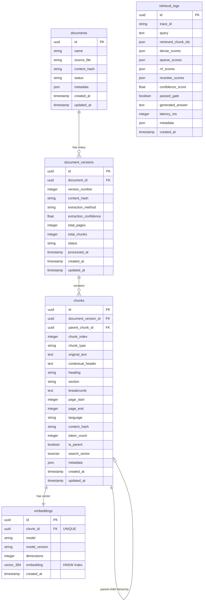

# 🚀 Production-Grade RAG Backend & Agentic AI (Laravel 13 + PostgreSQL pgvector)

Backend platform kecerdasan buatan (AI) berbasis **Laravel 13** dan **PostgreSQL 16 (pgvector)** yang melayani OpenAI-compatible chat completions endpoint, pencarian pengetahuan dokumen terintegrasi (RAG), serta **Agentic AI Tool Calling** untuk navigasi otomatis halaman & section website sekolah SMKN 26 Jakarta.

Platform ini dibangun dengan **$0 Budget Stack** (bebas biaya operasional) dan **Pure PHP Architecture** (tanpa dependensi Python/runtime eksternal).

---

## 📑 Daftar Isi

- [Fitur Utama](#-fitur-utama)
- [Arsitektur Sistem ($0 Budget Stack)](#-arsitektur-sistem-0-budget-stack)
- [Entity-Relationship Diagram (ERD)](#-entity-relationship-diagram-erd)
- [Struktur Sitemap Website Sekolah](#-struktur-sitemap-website-sekolah)
- [Cara Kerja Agentic AI & Cara Membedakan Respon](#-cara-kerja-agentic-ai--cara-membedakan-respon)
- [Panduan Instalasi & Setup Lokal](#-panduan-instalasi--setup-lokal)
- [Panduan Deployment Supabase (Free Tier)](#-panduan-deployment-supabase-free-tier)
- [Dokumentasi API Endpoints](#-dokumentasi-api-endpoints)

---

## ✨ Fitur Utama

1. **Pure PHP AI Engine (Zero Python)**:
   - **PDF Parser**: Menggunakan `smalot/pdfparser` untuk ekstraksi teks dokumen PDF secara murni dalam PHP.
   - **Vector Embeddings**: Menggunakan API gratis Gemini `gemini-embedding-001` (384 dimensi).
   - **Cosine Similarity Reranker**: Reranking vektor berkecepatan tinggi dalam PHP (<10ms).
2. **Hybrid Search & Vector Indexing**:
   - **Dense Vector Search**: Indeks HNSW (`vector_cosine_ops`) pada PostgreSQL `pgvector`.
   - **Sparse Text Search**: Indeks GIN pada kolom `tsvector` untuk pencarian kata kunci presisi.
   - **RRF Fusion**: Reciprocal Rank Fusion ($k=60$) menggabungkan hasil pencarian dense & sparse.
3. **Agentic AI Navigation Tool**:
   - Menggunakan format standar **OpenAI Function Calling** (`navigate_to_page`).
   - Secara otomatis mendeteksi ketika pengguna menanyakan lokasi halaman, lagu mars, jurusan, pendaftaran, atau kontak, lalu mengembalikan payload `tool_calls` berisi parameter rute (`page`) dan bagian (`section`).
4. **Grounding Ketat & Pertahanan Prompt Injection**:
   - Menjawab HANYA berdasarkan konteks dokumen atau merespon dengan pesan penolakan yang aman jika informasi tidak ditemukan.
   - Menyertakan sitasi persis `[Halaman X]` beserta Chunk ID sumber pengetahuan.

---

## 🏗 Arsitektur Sistem ($0 Budget Stack)

```
                       ┌────────────────────────┐
                       │   Client / Frontend    │
                       └───────────┬────────────┘
                                   │ HTTP POST /api/v1/chat/completions
                                   ▼
                       ┌────────────────────────┐
                       │ Laravel 13 RAG Backend │
                       └───────────┬────────────┘
                                   │
      ┌────────────────────────────┼────────────────────────────┐
      ▼                            ▼                            ▼
┌──────────────┐          ┌──────────────────┐        ┌──────────────────┐
│ Hybrid       │          │ Agentic AI Tool  │        │ LLM Provider     │
│ Retriever    │          │ Navigation       │        │ (Gemini / Groq)  │
└──────┬───────┘          └────────┬─────────┘        └────────┬─────────┘
       │                           │                           │
       ▼                           ▼                           ▼
┌──────────────┐          ┌──────────────────┐        ┌──────────────────┐
│ PostgreSQL   │          │ config/          │        │ OpenAI Compatible│
│ pgvector     │          │ navigation.php   │        │ JSON Response    │
└──────────────┘          └──────────────────┘        └──────────────────┘
```

---

## 📊 Entity-Relationship Diagram (ERD)

Diagram berikut menjelaskan struktur entitas dan relasi database `rag_knowledge` pada PostgreSQL `pgvector`:



### 🔑 Penjelasan Relasi Entitas:
- **`documents` (1) ── (N) `document_versions`**: Satu dokumen dapat memiliki beberapa versi proses ingestion.
- **`document_versions` (1) ── (N) `chunks`**: Satu versi dokumen dipecah menjadi banyak potongan teks (chunks).
- **`chunks` (1) ── (N) `chunks` (Self-Referencing)**: `parent_chunk_id` merujuk ke chunk induk (`is_parent = true`) untuk menjaga integritas konteks paragraf.
- **`chunks` (1) ── (1) `embeddings`**: Setiap child chunk memiliki 1 vektor embedding `vector(384)` dengan indeks HNSW (`vector_cosine_ops`).
- **`retrieval_logs`**: Tabel independen untuk merekam observabilitas, latensi, confidence score, dan trace log setiap query.

---

## 🗺 Struktur Sitemap Website Sekolah

Agentic AI secara otomatis mengenali seluruh peta situs web SMKN 26 Jakarta berikut:

* 🏠 **Beranda (`/`)**: Hero banner, berita terkini, pengumuman singkat.
* 🏫 **Tentang Kami (`/tentang`)**: Profil sekolah & sejarah (`profil-sejarah`), Visi & Misi (`visi-misi`), Profil Guru (`profil-guru`), Staf Manajemen (`staf-manajemen`), Fasilitas (`fasilitas`), Mars (`mars-smkn26`), Hymne (`hymne-smkn26`).
* 📚 **Program (`/program`)**: Profil Jurusan (`profil-jurusan`), Kerja Sama Industri (`kerja-sama-industri`), Program Unggulan (`program-unggulan`), Ekstrakurikuler (`ekstrakurikuler`), Produk Unggulan (`produk-unggulan`).
* 📰 **Informasi (`/informasi`)**: Berita (`berita`), Pengumuman (`pengumuman`), Prestasi (`prestasi`), Lulusan Terbaik (`lulusan-terbaik`), Alumni (`alumni`).
* 📸 **Dokumentasi (`/dokumentasi`)**: Galeri Foto (`galeri-foto`), Video (`video`), School Tour (`school-tour`), Kegiatan (`kegiatan`).
* 📝 **PPDB (`/ppdb`)**: Jadwal (`jadwal-ppdb`), Syarat (`syarat-pendaftaran`), Alur (`alur-pendaftaran`), FAQ (`faq-ppdb`).

---

## 🤖 Cara Kerja Agentic AI & Cara Membedakan Respon

Saat client mengirim permintaan ke endpoint `POST /api/v1/chat/completions`, ada **2 jenis respon utama** yang dapat diterima:

### 1. Respon Pertanyaan / RAG Biasa (`finish_reason: "stop"`)
Jika pengguna bertanya tentang isi materi/pengetahuan (misal: *"Apa visi SMK Negeri 26 Jakarta?"*), AI mengembalikan jawaban teks lengkap beserta sitasi dokumen.

**Contoh Response JSON**:
```json
{
  "choices": [
    {
      "index": 0,
      "message": {
        "role": "assistant",
        "content": "Berdasarkan dokumen basis pengetahuan [Halaman 1]: Visi SMKN 26 Jakarta adalah..."
      },
      "finish_reason": "stop"
    }
  ],
  "citations": [
    {
      "page": 1,
      "section": "Visi dan Misi",
      "chunkId": "911918eb-f491-4942-a46a-529165563bcf"
    }
  ]
}
```

### 2. Respon Tool Calling Navigasi (`finish_reason: "tool_calls"`)
Jika pengguna menanyakan lokasi halaman/section (misal: *"Di mana halaman mars smk26 apa ya?"*), AI merespon dengan `finish_reason: "tool_calls"` dan menyertakan struktur `tool_calls`.

**Contoh Response JSON**:
```json
{
  "choices": [
    {
      "index": 0,
      "message": {
        "role": "assistant",
        "content": "",
        "tool_calls": [
          {
            "id": "call_6a6403db8715a",
            "type": "function",
            "function": {
              "name": "navigate_to_page",
              "arguments": "{\"reason\":\"Pengguna menanyakan lokasi lagu mars sekolah.\",\"page\":\"tentang\",\"section\":\"mars-smkn26\"}"
            }
          }
        ]
      },
      "finish_reason": "tool_calls"
    }
  ]
}
```

#### 💡 Cara Frontend Membedakan Respon:
```javascript
const response = await fetch('/api/v1/chat/completions', { ... });
const data = await response.json();
const choice = data.choices[0];

if (choice.finish_reason === 'tool_calls') {
  // Aksi Navigasi Otomatis
  const toolCall = choice.message.tool_calls[0];
  const args = JSON.parse(toolCall.function.arguments);
  
  const targetPage = args.page;       // "tentang"
  const targetSection = args.section; // "mars-smkn26"
  
  // Arahkan router frontend (React/Vue/Next.js)
  router.push(`/${targetPage}#${targetSection}`);
} else {
  // Tampilkan Teks Jawaban Biasa
  console.log(choice.message.content);
}
```

---

## 🛠 Panduan Instalasi & Setup Lokal

### 1. Requirements
- PHP >= 8.3
- PostgreSQL 16+ dengan ekstensi `pgvector`
- Composer

### 2. Langkah Setup
```bash
# Clone & install dependensi
git clone <repository_url>
cd BACKEND
composer install

# Salin konfigurasi environment
cp .env.example .env

# Isi API Keys pada .env:
# GEMINI_API_KEY=AQ.Ab8RN6L9o...
# GROQ_API_KEY=gsk_v2XLFhTw...

# Jalankan migrasi database
php artisan migrate

# Ingest dokumen PDF ke dalam pgvector
php artisan rag:ingest --sync

# Jalankan server lokal
php artisan serve
```

---

## ☁️ Panduan Deployment Supabase (Free Tier)

Sistem ini dirancang 100% kompatibel dengan **Supabase Free Tier** yang menyediakan PostgreSQL + `pgvector` secara gratis.

### Langkah-Langkah Deployment Supabase:

1. Buat project baru di [Supabase Console](https://supabase.com).
2. Buka **SQL Editor** di dashboard Supabase dan aktifkan pgvector:
   ```sql
   CREATE EXTENSION IF NOT EXISTS vector;
   ```
3. Buka **Project Settings** -> **Database**, salin informasi koneksi:
   - Host: `db.xxxxxxxxxxxxxxxx.supabase.co`
   - Port: `5432`
   - Database: `postgres`
   - User: `postgres`
   - Password: `<password-database-anda>`
4. Update konfigurasi `.env` pada server/hosting Laravel Anda:
   ```env
   DB_CONNECTION=pgsql
   DB_HOST=db.xxxxxxxxxxxxxxxx.supabase.co
   DB_PORT=5432
   DB_DATABASE=postgres
   DB_USERNAME=postgres
   DB_PASSWORD=your-supabase-password
   DB_SSLMODE=require
   ```
5. Jalankan migrasi pada server produksi:
   ```bash
   php artisan migrate --force
   php artisan rag:ingest --sync
   ```

---

## 🔌 Dokumentasi API Endpoints

### 1. Chat Completion API
Endpoint utama untuk obrolan AI dan navigasi agentic.

- **URL**: `POST /api/v1/chat/completions`
- **Headers**: `Content-Type: application/json`
- **Body**:
  ```json
  {
    "messages": [
      {
        "role": "user",
        "content": "dimana halaman mars smk26 apa ya?"
      }
    ]
  }
  ```

---

## 📄 Lisensi
MIT License - Bebas digunakan dan dikembangkan untuk platform edukasi SMKN 26 Jakarta.
